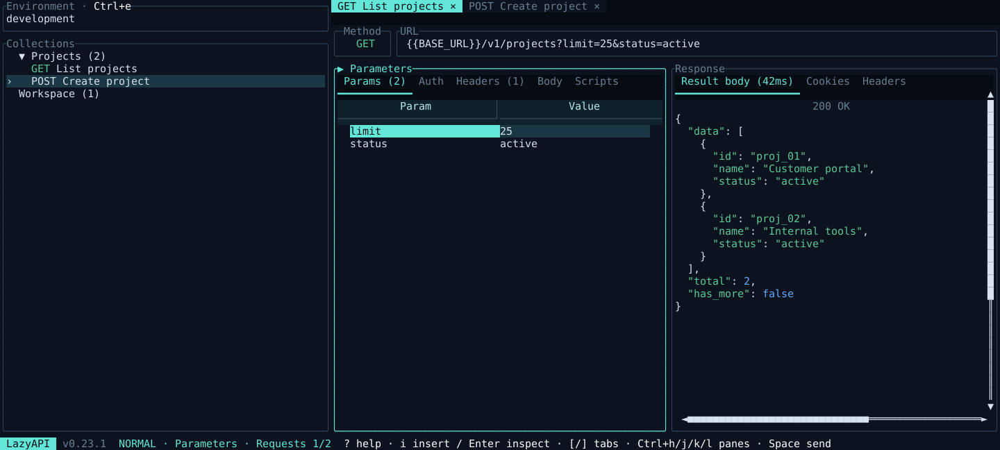

# LazyAPI

[](https://github.com/giofahreza/LazyAPI/actions/workflows/rust.yml)
[](LICENSE)

LazyAPI is a terminal API client for HTTP and WebSocket requests. Manage requests,
collections, environments, and scripts locally, without an account or cloud sync.



## Install from this checkout

Requirements: Rust 1.90 or newer, Cargo, Python 3, and a C/C++ build toolchain.

```sh
git clone https://github.com/giofahreza/LazyAPI.git
cd LazyAPI
python3 scripts/install-local.py
lazyapi
```

The installer builds the release binary with the locked dependencies and installs
it to `~/.local/bin/lazyapi`. Add `~/.local/bin` to your `PATH` if necessary.
It also installs shell completions, the manual page, and the license. The previous
executable is kept under `$XDG_STATE_HOME/lazyapi/previous/`, which defaults to
`~/.local/state/lazyapi/previous/`. Collections and environments are left intact.
Restart an open app to use the new build.

After every change to this checkout, run the relevant checks and reinstall:

```sh
cargo build --release --locked --bin lazyapi
LAZYAPI_BIN=target/release/lazyapi python3 -m unittest discover -s tests -v
python3 scripts/install-local.py
```

For a standard Cargo installation on other machines:

```sh
cargo install --path . --locked --force
```

## Usage

```sh
lazyapi                                      # Open the terminal UI
lazyapi --help                               # Show commands and options
lazyapi --version                            # Show the installed version
lazyapi --dry-run collection list            # Inspect saved collections
lazyapi --directory ./collections            # Use a specific collection folder
lazyapi --dry-run --directory ./collections  # Browse without saving changes
```

Create a collection and a request from the CLI:

```sh
lazyapi collection new Example
lazyapi request new Example/Get --url https://example.com
lazyapi request info Example/Get
```

Use `lazyapi <command> --help` for command-specific options. Requests are sent only
when you ask the app to send them. Press `?` in Normal mode for keyboard shortcuts,
and `q` to quit from the workspace.

The default controls follow Neovim and LazyDB: `h/j/k/l` navigate within a pane,
`Ctrl+h/j/k/l` change pane, and `[` / `]` switch open request tabs. Open requests
with Enter in Collections; close a tab with `X`. Press `a` in Collections to add
a collection, blank request, or cURL request, or in a table to add a row. A cURL
request accepts a pasted multiline command and imports its method, URL, parameters,
headers, authentication, and body. Press `d` to delete the selected item;
collections and requests ask for confirmation. On a value, Enter opens the
editor in Normal mode; inside it, `i/a/I/A` insert or append. Esc keeps your draft and returns
to Normal. Use `:w` to save and keep editing, `:wq` or Ctrl+s to save and finish,
and `:q!` or Ctrl+c to discard. The footer names the field and marks unsaved edits
with `[+]`. `Ctrl+w h/j/k/l` also changes panes. Pane/tab navigation saves the
current field; Tab / Shift+Tab switch panels in Normal mode. `?` opens help in
Normal mode, and F1 works while typing. See the [keyboard reference](docs/keybindings.md).

Press `/` to search the focused list or view, including Collections, environments,
variables, keyboard shortcuts, parameter/header/form tables, cookies, responses,
logs, and request exports. Type to filter, use arrows or `Ctrl+n/p` to select,
and Enter to jump to a match. Use `n` / `N` for the next / previous match;
Esc cancels the search dialog or clears an accepted search. In Collections,
search also finds requests inside collapsed collections by name, method, or URL.
Enter again opens the selected request. Inside an editor, `/` uses Vim search.

Text bodies and WebSocket messages open directly in Normal mode with a visible
cursor; typing updates the displayed draft immediately. The interface uses
LazyDB's Deep Space colors, rounded panels, compact request tabs, and underlined
section tabs. Branding, mode, and solid-white shortcut hints share one bottom
row. Tabs scroll to keep the active request visible. Below 100 columns, the
focused pane fills the workspace; `Ctrl+h/j/k/l` still changes panes.

Press `Ctrl+e` for the environment manager. Use `Ctrl+h/l` or Tab to switch
between the environment list and its variable table. In the list, `a` creates,
`r` renames, and `d` deletes an environment with confirmation. Enter activates
the selected environment. In the table, `a` adds a variable, `Enter` or `i`
opens a cell, and `d` deletes a variable. `N` creates an environment from either
pane. Use variables as `{{BASE_URL}}` or `{{API_TOKEN}}` in requests.

The CLI also supports environment management:

```sh
lazyapi env new Development
lazyapi env key Development add BASE_URL https://example.com
lazyapi env key Development set BASE_URL https://staging.example.com
lazyapi env rename Development Staging
lazyapi env list
lazyapi env delete Staging
```

## Collections and configuration

On Linux, the default application directory is `$XDG_CONFIG_HOME/lazyapi`, or
`~/.config/lazyapi` when `XDG_CONFIG_HOME` is unset. Other platforms use their
standard per-user configuration directory for LazyAPI.

The directory contains:

- JSON or YAML collection files, including saved requests and headers.
- `.env.<name>` files for environments.
- `lazyapi.toml` for settings specific to that directory.
- `lazyapi.log` for terminal UI logs.

`global.toml` in the default configuration directory supplies fallback settings.
Collection formats and saved request values are independent of the app name.
`--dry-run` prevents collection and environment writes; the terminal UI still
writes its log file.

| Variable | Purpose |
| --- | --- |
| `LAZYAPI_MAIN_DIR` | Default collection directory; `--directory` takes precedence. |
| `LAZYAPI_THEME` | Path to a theme TOML file. |
| `LAZYAPI_KEY_BINDINGS` | Path to a key bindings TOML file. |

Example configuration in `lazyapi.toml`:

```toml
save_requests_response = true
wrap_responses = true
preferred_collection_file_format = "json"
```

Themes and key bindings are available in [example_resources](example_resources).
The [default theme](example_resources/themes/default_theme.toml) contains the
Deep Space colors and can be copied to customize them. Older theme files still
load; optional `[palette]` colors inherit the default values. For example, from
the repository root:

```sh
LAZYAPI_THEME=example_resources/themes/default_theme.toml \
LAZYAPI_KEY_BINDINGS=example_resources/key_bindings/vim_key_bindings.toml \
lazyapi
```

New requests use `LazyAPI/v<version>` as their default User-Agent. Saved request
headers keep their existing values.

## Features

- HTTP and WebSocket requests, collections, and environment variables.
- Query parameters, headers, cookies, and multiple request body formats.
- Basic, bearer, digest, and JWT authentication.
- JavaScript scripts before and after requests.
- Response images and request exports.
- Import from Postman collections and environments, cURL, and OpenAPI.
- Multiple request tabs with independent responses, panel selections, and scroll.
- Vim Normal/Insert editing, directional pane focus, and a scrollable shortcut modal.
- Themes and configurable key bindings, including Vim and Emacs presets.
- Terminal UI and command-line workflows.

## Shell completions and manual

The local installer writes:

- Bash: `~/.local/share/bash-completion/completions/lazyapi`.
- Zsh: `~/.local/share/zsh/site-functions/_lazyapi`.
- Fish: `~/.config/fish/completions/lazyapi.fish`.
- Manual: `~/.local/share/man/man1/lazyapi.1`.

These paths honor `XDG_DATA_HOME` and `XDG_CONFIG_HOME`. For Zsh, add the completion
directory to `fpath` before calling `compinit` in your shell configuration.

You can also generate them yourself in an existing directory:

```sh
lazyapi completions zsh ./completions
lazyapi man ./man
```

## Docker

Build and run a local image with an existing collection directory mounted:

```sh
docker build --build-arg RUST_VERSION=1.90 -t lazyapi .
docker run --rm -it -v "$PWD/collections:/data" lazyapi --directory /data
```

The Docker workflow publishes this repository's image to GitHub Container Registry
under `ghcr.io/giofahreza/lazyapi`. Release archives contain the `lazyapi` executable.

## License

[MIT](LICENSE). The original copyright and permission notices are preserved.
